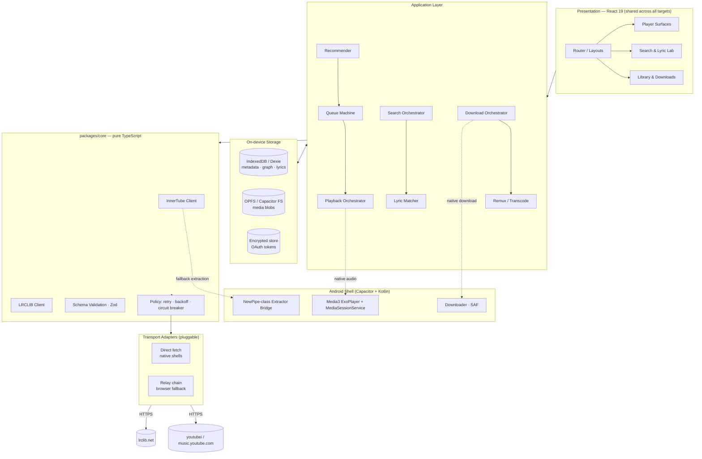

# TheMashup — Master Plan & Scope Charter

> **Document 0 of 5 — Phase 0 deliverable**
> Status: `APPROVED-PENDING` · Owner: Autonomous Systems Architect · Last revised: 2026-11-08

---

## 1. One-Paragraph Vision

**TheMashup** is a serverless, cross-platform music streaming and downloading client that gives a
user the full depth of the YouTube Music catalogue — search, radio, library, lyrics, playback and
downloads — through a **custom, butter-smooth interface** built entirely from scratch. There is no
backend. There is no VPS. There is no database you pay for. Every byte of catalogue access is
obtained by the client talking directly to the upstream APIs (`youtubei`/InnerTube, LRCLIB), every
byte of recommendation intelligence is computed **on the device**, and every byte of downloaded media
is written **to the device**. The app is Android-first, web-previewable, and desktop-ready by
architecture, not by promise.

---

## 2. Non-Negotiable Constraints

| # | Constraint | How it is structurally enforced |
|---|---|---|
| C1 | **Zero server dependency** | The build is a static bundle (`dist/`). CI produces artifacts, not deployments. Any file under `server/` in a PR fails review. |
| C2 | **Zero hosting cost** | No runtime process. Web build can be served from a file:// path, a static CDN, or embedded in the native shell assets. |
| C3 | **Client-side extraction only** | All catalogue logic lives in `packages/core` — pure TypeScript, no Node APIs, no secrets. |
| C4 | **No secrets in the client** | Only *public* OAuth client IDs and public API base URLs ship. No `client_secret`, no signing keys. |
| C5 | **Zero-bug / zero-crash policy** | Every boundary is total: every async call returns a `Result`, every upstream payload is schema-validated, every route is wrapped, every boot is recoverable. |
| C6 | **Android first, Windows later** | Mobile performance budgets, touch targets and haptics are primary; desktop is a shell swap of the same UI. |

> **Honesty clause.** Two specification items are technically impossible as literally described and are
> re-specified here rather than faked:
>
> 1. **"FLAC across bitrates."** YouTube Music's ceiling is 256 kbps AAC (itag 141, Premium) or
>    ~160 kbps Opus (itag 251). There is **no lossless source**. "FLAC" therefore means *lossless
>    container, transcoded from the best available lossy stream* — it does not restore missing data.
>    The UI will label it "FLAC (transcoded)" and never claim bit-perfect audio. See §6 / R7.
> 2. **"Adaptive bitrate tiers."** Upstream offers a fixed ladder (48/64/128/160/256 kbps audio,
>    144p→2160p video). The UI exposes the *actual* ladder returned per track, not a fictitious one.
>    If Premium formats are unavailable for a track, the tier is shown as locked, not silently substituted.

---

## 3. What "Harvesting Open-Source Modules" Actually Means

We are **not** forking OuterTune, LibreTube or NewPipe. Two of them are Kotlin/Android-first and one is
GPLv3. Copying their engines into a TypeScript app is neither portable nor license-clean. Instead we
extract **battle-tested patterns, protocol knowledge and call-sequences** and re-implement them
idiomatically. See `03-OSS-HARVEST.md` for the full attribution and license matrix.

| Source | What we take | Form of adaptation |
|---|---|---|
| **OuterTune** (GPLv3, fork of InnerTune) | InnerTube request body shapes; `SAPISIDHASH` signing; radio (`RDAMVM`) conventions; queue/gapless rules | Re-implemented in TypeScript from protocol observation. GPLv3 code is **not** copied. *(OAuth device-code was evaluated and rejected — it needs a client secret; see Amendment A-1.)* |
| **LibreTube** (GPLv3) | Notification/`MediaSession` lifecycle discipline; foreground-service policy for long playback; "proxy-by-default" transport fallback ladder | Re-implemented as a Kotlin Media3 service + a TS transport adapter chain. |
| **NewPipe Extractor** (GPLv3, *optional native dependency*) | Signature/`n-sig` and PoToken strategies, format extraction rules | Used as an **optional runtime dependency** behind a Kotlin plugin boundary (see ADR-005), or reimplemented. |
| **Ryder / SimpMusic / ViMusic** (reference only) | UX conventions for lyric views and mini-player gestures | Design reference only. No code. |

---

## 4. Phase Roadmap & Gates

Each phase ends with a **Progress Report** and an explicit **permission request**. No phase may begin
before the gate is cleared. Gates are listed with objective exit criteria so "done" is not a matter of
opinion.

### Phase 0 — Master Plan & Architecture Blueprint ← *current*
- [x] Scope charter, constraint model, honesty clause
- [x] System architecture, layer diagram, module map
- [x] Tech stack decision matrix + ADRs
- [x] Open-source harvest & license matrix
- [x] Design system / motion specification (pre-code)
- **Gate G0:** documents reviewed; 4 architectural decisions ratified.

### Phase 1 — Deep Technical Research & API Strategy ✅
- [x] `youtubei` endpoint catalogue: `search`, `browse`, `next`, `player`, `get_search_suggestions` (+ write endpoints)
- [x] Client-profile matrix and which profiles are free of PoToken/cipher
- [x] Search-filter protobuf parameter table (songs/albums/artists/playlists/podcasts/uploads/library)
- [x] PoToken risk analysis and the resolution ladder
- [x] Lyrics pipeline: LRCLIB contract read from source, local BM25 index design
- [x] Recommendation heuristic spec (structural + affinity graph + ε-greedy)
- [x] Storage schema (IndexedDB + OPFS), eviction policy, cache-key strategy
- [x] Error taxonomy, retry/backoff/circuit-breaker, safe-mode boot
- [x] Download engine spec with an honest capability matrix
- [x] **Two runnable spikes** (41 + 22 checks, all passing offline)
- **Gate G1:** endpoint catalogue frozen. *Live verification deferred to the in-app Diagnostics probe
  (this sandbox has no YouTube/LRCLIB egress) — see report.*

### Phase 2 — Web Application Core (Foundation)
- [ ] Vite + React 19 + TS + Tailwind v4 + Framer Motion scaffold; design tokens; app shell
- [ ] Motion layer: route transitions, shared-element album art, gesture mini-player
- [ ] Smart search: unified suggestions, filters, fuzzy lyric recognition
- [ ] Google Sign-In (device-code OAuth) + library sync
- [ ] Player engine (Web Audio / `HTMLAudioElement` + Media Session) and queue machine
- [ ] Download manager: format ladder, queue, concurrency, remux/transcode
- [ ] Error boundaries, persistence, safe-mode
- **Gate G2:** deployed static build previews; search→play→download works end-to-end; crash-free 30-min soak.

### Phase 3 — Android Client *(promoted ahead of Desktop by user instruction)*
- [ ] Capacitor shell, `app.themashup.music`
- [ ] Kotlin plugin: `NewPipe`-class extractor bridge (optional/fallback path)
- [ ] Kotlin plugin: Media3 `ExoPlayer` + `MediaSessionService` (background, lockscreen, media keys, notifications)
- [ ] Native downloads (OkHttp + MediaMuxer/FFmpeg), scoped-storage/SAF handling
- [ ] Touch-first layouts, haptics, predictive back, edge-to-edge
- [ ] Release APK (signed, minified, R8), baseline profiles
- **Gate G3:** signed APK installs; audio survives screen-off for 60 min; lockscreen controls verified on 2 Android versions.

### Phase 4 — Desktop (Windows) Client — *deferred*
- [ ] Tauri 2 wrapper, native fetch (no CORS), tray, system media keys via SMTC, notifications
- [ ] Memory-leak profiling, crash stress, installer (MSI/NSIS)
- **Gate G4:** MSI installs; media keys + tray verified; 4-hour leak soak flat.

> **Order change recorded:** the user promoted Android above Windows. Phase numbering is preserved for
> traceability; execution order is 0 → 1 → 2 → 3 → 4.

---

## 5. Architecture in One Diagram

---

## 6. Risk Register

| ID | Risk | Severity | Probability | Mitigation |
|---|---|---|---|---|
| R1 | **CORS** blocks `youtubei` in a plain browser | High | Certain | Transport adapter chain: native shells fetch directly; browser falls back to a ranked relay list. Degrades, never crashes. |
| R2 | **PoToken / BotGuard** enforcement widens, breaking stream URLs | High | Likely | Multi-client fallback ladder → native extractor bridge → clear "unavailable in your region/client" surface. Never a white screen. |
| R3 | Upstream payload drift breaks parsers | High | Certain (over time) | Every response Zod-validated; unknown shapes degrade to a typed `ParseError`; remote-free "compat shim" layer maps old→new field names. |
| R4 | Google blocks the public OAuth client ID | Medium | Possible | Auth is **optional**; app is fully functional anonymous. Token failure = silent downgrade to anonymous mode. |
| R5 | Browser storage eviction deletes downloads | Medium | Likely | `navigator.storage.persist()`, LRU eviction of *cache* only, never of user-initiated downloads; `export/import` backup file. |
| R6 | Background audio killed by Android OEM battery optimizers | High | Likely | Foreground `MediaSessionService` + persistent notification + exact `WAKE_LOCK`; documented per-OEM guidance screen. |
| R7 | "FLAC" quality expectation mismatch | Medium | Certain | UI labels transcode honestly; settings explain source ceiling. |
| R8 | Legal / ToS exposure | — | — | Personal-use client, no redistribution of media, no bundled credentials. Downloads are user-initiated and stored locally only. |
| R9 | GPL contamination from harvested code | Medium | Possible | No GPL source copied; optional native dependency documented as such; see `03-OSS-HARVEST.md` §4. |

---

## 7. Quality Bar (Definition of Done, every phase)

1. **No `any`.** `strict`, `noUncheckedIndexedAccess`, `exactOptionalPropertyTypes`.
2. **No unhandled promise.** ESLint `no-floating-promises` as an error.
3. **Every route** has an error boundary + suspense skeleton + empty state + offline state.
4. **Every network call** is schema-validated, time-boxed, retried with jitter, and circuit-broken.
5. **Every animation** uses spring physics and respects `prefers-reduced-motion`.
6. **Every interactive element** has ≥44×44 dp touch target, focus ring, and ARIA role.
7. **60 fps** on a mid-range Android device; Long Task budget ≤50 ms; initial JS ≤180 KB gzip for the shell.
8. **Crash-free session ≥99.5%** across a 30-minute randomized soak test.

---

## 8. Explicit Non-Goals (v1)

- Podcasts, audiobooks, live radio, community-playlist editing.
- Multi-user sync / social graph (would require a server).
- Lossless audio (impossible — see §2).
- DRM circumvention beyond what an authenticated user is already entitled to stream.
- Windows/macOS/Linux packaging (Phase 4, deferred).
