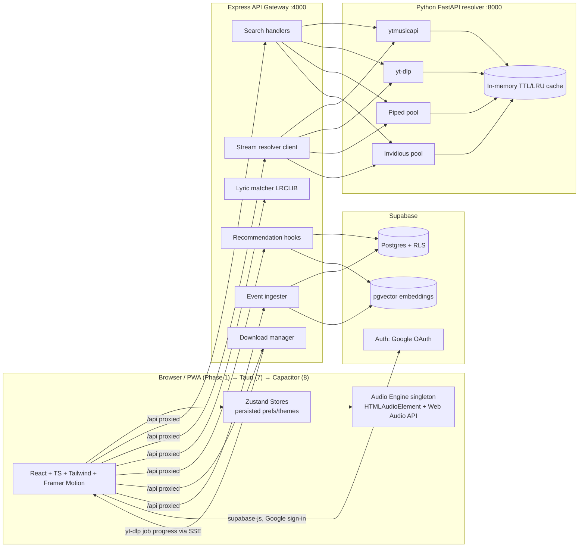

# TheMashup — Master Architectural Blueprint (Phase 1)

> **Status:** Phase 1 deliverable — awaiting sign-off before any code is written.
> **Date:** 2026-10-27 · **Branch:** `arena/af3d0d7b-themashup`

---

## 1. Vision & Non-Negotiables

TheMashup is a cross-platform music ecosystem: an aggregated streaming library with
YouTube-Music-grade personalization, lyric-based search, full audio/video downloads,
Google auth with cloud sync, and a path from **Web PWA → Windows desktop → Android APK**.

Hard requirements carried through every phase:

| Requirement | Architectural consequence |
|---|---|
| Zero crashes, zero memory leaks | Single audio engine singleton, strict React error boundaries, abortable fetches, analyser-node teardown, capped caches |
| Playback never interrupts | Multi-source stream resolver with pre-validated candidate lists + mid-playback silent failover (position-preserving) |
| 60fps animations | Framer Motion + CSS transforms only (no layout-thrash), Web Audio `AnalyserNode` for visualizer, GPU-friendly blur layers |
| Persistent user experience | Zustand `persist` middleware (localStorage) for prefs/themes/volume — **survives restart** |
| Cross-platform synergy | pnpm monorepo; `packages/shared` types/logic reused by web, desktop (Tauri), mobile (Capacitor) |

---

## 2. Confirmed Decisions (Phase 1 Q&A)

1. **Backend architecture:** React SPA (Vite) + **Node/Express API gateway** + **Python FastAPI resolver microservice** wrapping `ytmusicapi` / `yt-dlp`.
2. **Visual identity:** **5 user-selectable themes**, all persisted across restarts:
   - **Frosted Glass** *(default)* — near-black glassmorphism with dynamic blurred album-art gradients.
   - **Paper & Ink** — light, typographic, warm paper background, ink-black text, minimal chrome.
   - **Neon Cyber** — dark canvas, vivid neon accent glows, saturated gradient edges.
   - **Aurora** — deep slate with flowing teal→violet mesh gradients and soft glows.
   - **Vinyl** — warm retro dark: cream/oxblood/amber accents, subtle grain, nostalgic EQ styling.
3. **Auth + DB:** **Supabase everything** — Supabase Auth (Google OAuth), Supabase Postgres, **pgvector** for recommendation embeddings.
4. **Workspace:** **pnpm monorepo** from day one (web, api, python resolver, shared package, desktop, mobile).

---

## 3. High-Level System Architecture



**Dev proxy chain (no CORS pain, preview-safe):**
`browser → Vite :5173 (/api → Express :4000) → Express (/resolver → FastAPI :8000)`
**Production:** Express serves the built SPA and keeps the same proxy chain (single public origin).

---

## 4. Monorepo Folder Structure

```
TheMashup/
├── package.json                  # pnpm workspace root, orchestration scripts
├── pnpm-workspace.yaml
├── turbo.json                    # task graph (build/lint/test per package)
├── .env.example                  # all keys documented, never committed
├── docker-compose.yml            # optional: resolver + gateway for local prod parity
│
├── apps/
│   └── web/                      # Phase 3 — React 18 + Vite + TypeScript + Tailwind
│       ├── index.html
│       ├── vite.config.ts        # proxy: /api → :4000
│       └── src/
│           ├── main.tsx
│           ├── App.tsx           # router + ErrorBoundary + theme boot
│           ├── engine/           # AudioEngine singleton, analyser, failover hooks
│           ├── stores/           # zustand slices (see §7)
│           ├── components/
│           │   ├── player/       # floating bar, expanded modal, queue drawer
│           │   ├── search/       # smart search overlay, suggestion rows, chips
│           │   ├── library/      # playlists, likes, history
│           │   ├── downloads/    # quality picker, progress rows
│           │   ├── lyrics/       # synced lyric scroller
│           │   └── visual/       # visualizer, art-gradient background
│           ├── themes/           # 5 theme tokens (see §8)
│           ├── hooks/
│           ├── pages/
│           └── lib/              # supabase client, api client, formatters
│
├── apps/
│   └── api/                      # Phase 2 — Express gateway (TypeScript)
│       └── src/
│           ├── server.ts
│           ├── middleware/       # authVerify (Supabase JWT), rateLimit, errors
│           ├── routes/           # search, streams, lyrics, recs, downloads, events
│           ├── services/         # resolverClient, lrclib, supabaseAdmin, sseHub
│           └── downloads/        # job queue, yt-dlp orchestration, progress emit
│
├── services/
│   └── resolver/                 # Phase 2 — Python FastAPI microservice
│       ├── pyproject.toml
│       └── app/
│           ├── main.py
│           ├── search.py         # ytmusicapi + Piped/Invidious search
│           ├── streams.py        # candidate resolution + health ordering
│           ├── formats.py        # yt-dlp format manifests (audio/video qualities)
│           ├── cache.py          # TTL + LRU in-memory cache
│           └── config.py         # instance pools, timeouts, retries
│
├── packages/
│   └── shared/                   # types + pure logic reused by ALL platforms
│       └── src/
│           ├── types/            # Track, StreamCandidate, Playlist, DownloadJob…
│           ├── constants/        # qualities, repeat modes, theme ids
│           └── utils/            # duration fmt, fuzzy match, ranking score
│
├── desktop/                      # Phase 7 — Tauri (Rust + reused apps/web build)
├── mobile/                       # Phase 8 — Capacitor wrapping apps/web
├── docs/
│   └── ARCHITECTURE.md           # ← this document
└── scripts/                      # dev:all, db:migrate, seed
```

---

## 5. Data Flows

### 5.1 Playback with silent stream failover (core flow)

```
User taps play
  → POST /api/streams { trackId }
  → Express asks resolver: GET /resolver/streams/:videoId
  → resolver returns ORDERED candidates:
      [0] Piped mirror A (opus 160)   [1] Invidious mirror B (m4a 128)
      [2] Piped mirror C              [3] yt-dlp direct (best audio)
  → gateway HEAD-checks top candidates (parallel, 1.5s budget), returns validated list
  → AudioEngine loads candidate[0]; stores remaining as standby
  → on `error` / stalled / 403 mid-playback:
      → engine picks next candidate, restores currentTime + volume,
        resumes silently (no UI error; only a subtle toast if ALL fail)
  → on track end: standby list refreshed for next queue item (prefetch)
```

Rules: stream URLs are treated as **ephemeral** (never persisted); candidates carry
`expiresAt`; the engine refreshes a candidate list when <60s of validity remains.

### 5.2 Smart hybrid search

```
keystroke → debounce(150ms) → parallel fan-out:
  A) GET /api/search?q=           (ytmusicapi/Piped: tracks, artists, albums)
  B) GET /api/lyrics/match?q=     (LRCLIB synced-lyrics fuzzy match)
  C) GET /api/suggest?q=          (top-N title/artist autocomplete)
→ merge + rank in packages/shared (exact title/artist boost, then lyric similarity
  via token-set ratio, then popularity prior)
→ dropdown renders: track rows (inline play), artist chips, "matched lyric" badge
  with the matching line snippet highlighted
```

### 5.3 Recommendations & Radio

```
Client emits play_events (play/skip/complete/like/dislike/repeat, listened_ms, context)
  → POST /api/events → Postgres play_events (RLS: own rows)
Nightly/on-write worker → features:
  - content: artist/album/genre co-occurrence, duration, era, popularity
  - collaborative: user-item interactions (likes, completes, skips)
  → normalized embedding vector(256) → track_embeddings (pgvector, cosine)
Radio(seed):
  → k-NN over pgvector (seed ± related artists), MMR re-rank for diversity,
    freshness bonus, dislike-suppression filter → endless re-seeded queue
Quick Picks: “recent completes + high listened_ms, diverse by artist, 30d window”
Discover Weekly: collaborative signal (users with similar taste) + cold-start seed
```

### 5.4 Downloads

```
Quality picker (MP3 128/320, FLAC/Opus best, MP4 360→4K)
  → POST /api/downloads { trackId, container, quality }
  → Express enqueues job (concurrency 2) → yt-dlp subprocess via resolver service
  → states: queued → downloading(progress%) → processing metadata (ID3 tags,
    artwork embed) → completed | failed(retryable)
  → progress over SSE (/api/downloads/stream): percent, speed, ETA
  → Web: save to browser (blob/anchor) or server temp folder;
    Phase 7: Tauri FS dialog → native folder; Phase 8: Android scoped storage
```

### 5.5 Auth & sync

```
Google sign-in → supabase-js Auth (client) → session in localStorage (Supabase SDK)
Authenticated API calls → Authorization: Bearer <sb jwt> → Express `authVerify`
  (verifies JWT signature via Supabase JWKS, attaches req.user)
Writes → Supabase Postgres with RLS: users see/modify only their rows
Cross-device: playlists/likes/history sync on login (server is source of truth;
local Zustand cache hydrates first for instant paint, then reconciles)
```

---

## 6. API Surface (Express gateway)

| Method | Endpoint | Purpose |
|---|---|---|
| GET | `/api/health` | liveness + resolver/piped pool status |
| GET | `/api/search?q=&type=auto` | merged metadata search |
| GET | `/api/suggest?q=` | autocomplete (top 8) |
| GET | `/api/lyrics/match?q=` | lyric → track fuzzy resolution |
| GET | `/api/lyrics/:trackId` | synced (LRC) + plain lyrics |
| POST | `/api/streams` | ordered, validated stream candidates |
| GET | `/api/track/:id` | rich metadata (art, album, related) |
| GET | `/api/related/:id` · `/api/artist/:id` | radio seeds, artist page |
| GET | `/api/recommendations?kind=quick\|discover` | personalized shelves |
| POST | `/api/radio` | endless queue from seed track |
| POST | `/api/events` | listening events (auth) |
| GET/POST/DELETE | `/api/library/*` | likes, playlists, history, follows (auth) |
| POST | `/api/downloads` · GET `/api/downloads/:id` | create/inspect job (auth) |
| GET | `/api/downloads/stream` | SSE progress channel |

Python resolver (internal only, never exposed to browser):
`GET /resolver/search`, `/resolver/streams/:videoId`, `/resolver/formats/:videoId`,
`/resolver/meta/:videoId`, `/resolver/health`.

**Rate limiting:** per-IP token bucket on search/streams (generous), stricter on
downloads; resolver caches search results 5 min, metadata 24h, stream candidates
until expiry.

---

## 7. Local State Design (Zustand)

| Store | State (key parts) | Persistence |
|---|---|---|
| `playerStore` | currentTrack, status, position, duration, volume, muted, shuffle, repeatMode, rate | volume/shuffle/repeat via `persist` |
| `queueStore` | queue[], index, history[], seedContext | — (session) |
| `searchStore` | query, results, suggestions, open, loading, abortCtrl | — |
| `libraryStore` | likes, playlists, history (server-hydrated cache) | `persist` (instant offline paint) |
| `downloadStore` | jobs: Record<id, Job>, activeCount | completed jobs summary via `persist` |
| `sessionStore` | user, status | Supabase SDK manages tokens |
| `uiStore` | **themeId (5 themes)**, sidebarOpen, playerExpanded, queueOpen, visualizerOn, reducedMotion | **`persist` → survives restart** |
| `prefsStore` | preferredAudioQuality, preferredVideoQuality, crossfade, autoPlayNext | `persist` |

**Audio engine** is deliberately *outside* React state: a module-level singleton class
(`engine/audioEngine.ts`) wrapping `<audio>` + `AudioContext → MediaElementSource →
AnalyserNode → Gain → Destination`. Subscribers read via thin Zustand bindings.
Teardown rules: one AudioContext per app lifetime, analyser data read in a single
rAF loop (cancelled on unmount), event listeners removed on destroy → **no leaks**.

---

## 8. Theme System (5 persistent themes)

- **Mechanism:** CSS custom properties (HSL tokens) on `:root[data-theme="…"]`;
  Tailwind maps utilities to `var(--…)` tokens → zero per-theme class branching.
- **Theme ids:** `frosted` (default), `paper-ink`, `neon`, `aurora`, `vinyl`.
- **Dynamic album art:** extracted dominant colors (Canvas sampling of the artwork,
  cross-origin-safe fallback to a fixed palette) feed `--art-1/--art-2` variables;
  each theme defines its own blend mode/opacity so art-glow behaves differently per
  theme (e.g., invisible on Paper & Ink, vivid on Frosted, tinted on Vinyl).
- **Persistence:** `uiStore` uses Zustand `persist` (localStorage key `themashup.ui`)
  → selection survives full restart; applied before first paint via a tiny inline
  script in `index.html` (no theme flash).
- **Sync (optional, Phase 4):** last-known `themeId` also saved to the user profile
  so the choice follows the account across devices.

---

## 9. Database Schema (Supabase Postgres + RLS)

```sql
-- auth.users is managed by Supabase Auth (Google OAuth)
create table profiles (
  id uuid primary key references auth.users(id) on delete cascade,
  display_name text, avatar_url text, theme_id text default 'frosted',
  created_at timestamptz default now()
);

create table artists   ( id bigserial primary key, name text not null,
                         image_url text, metadata jsonb default '{}' );
create table albums    ( id bigserial primary key, title text not null,
                         artist_id bigint references artists(id),
                         cover_url text, release_year int );
create table tracks (
  id bigserial primary key,
  source text not null,            -- 'yt' | 'piped' | 'invidious'
  external_id text not null,       -- video/audio id
  title text not null, artist_name text, album_name text,
  duration_sec int, artwork_url text,
  popularity int, metadata jsonb default '{}',
  unique (source, external_id)
);

create table playlists (
  id uuid primary key default gen_random_uuid(),
  owner_id uuid not null references profiles(id) on delete cascade,
  title text not null, description text, cover_url text,
  is_public boolean default false,
  created_at timestamptz default now(), updated_at timestamptz default now()
);
create table playlist_tracks (
  playlist_id uuid references playlists(id) on delete cascade,
  track_id bigint references tracks(id) on delete cascade,
  position int not null, added_at timestamptz default now(),
  primary key (playlist_id, track_id)
);

create table likes (
  user_id uuid references profiles(id) on delete cascade,
  track_id bigint references tracks(id) on delete cascade,
  kind text check (kind in ('up','down')) not null,
  created_at timestamptz default now(),
  primary key (user_id, track_id)
);

create table follows (
  user_id uuid references profiles(id) on delete cascade,
  artist_id bigint references artists(id) on delete cascade,
  primary key (user_id, artist_id)
);

create table play_events (
  id bigserial primary key,
  user_id uuid references profiles(id) on delete cascade,
  track_id bigint references tracks(id),
  event_type text check (event_type in
    ('play','skip','complete','repeat','like','dislike')),
  listened_ms int default 0,
  context text,                     -- 'radio' | 'queue' | 'search' | 'playlist'
  created_at timestamptz default now()
);
create index on play_events (user_id, created_at desc);

create table downloads (
  id uuid primary key default gen_random_uuid(),
  user_id uuid references profiles(id) on delete cascade,
  track_id bigint references tracks(id),
  container text check (container in ('mp3','flac','opus','mp4')),
  quality text not null,            -- '128k','320k','best','720p','1080p','4k'
  status text default 'queued',
  progress numeric default 0, speed_bps bigint, filepath text,
  created_at timestamptz default now()
);

-- recommendation vectors
create extension if not exists vector;
create table track_embeddings (
  track_id bigint primary key references tracks(id) on delete cascade,
  embedding vector(256),
  updated_at timestamptz default now()
);
create index on track_embeddings
  using ivfflat (embedding vector_cosine_ops) with (lists = 100);
```

**RLS:** every user-owned table (`profiles`, `playlists`, `likes`, `follows`,
`play_events`, `downloads`) enables RLS with `owner_id/user_id = auth.uid()` policies;
public read on `tracks/artists/albums`; embedding table server-read only (service role).

---

## 10. Download Manager — Quality Matrix

| Type | Options | Source |
|---|---|---|
| Audio | MP3 128k, MP3 320k (ffmpeg transcode), Opus/FLAC best-available | yt-dlp format select + ffmpeg |
| Video | MP4 360p, 720p, 1080p, 4K60 (best ≤ requested) | yt-dlp `-f bv*+ba/b[height<=H]` |

Job lifecycle: `queued → downloading → processing metadata → completed | failed`;
live percent/speed via SSE; retries with backoff; duplicate (track+quality) dedupe.

---

## 11. Animation & Visual Plan (Phase 3/6 scope, designed now)

- **Framer Motion:** route/page transitions (AnimatePresence), player expand/collapse
  (shared layoutId), queue drawer slide, search overlay spring, playlist reorder
  (Reorder), micro-press/hover states.
- **Visualizer:** `AnalyserNode` → 32–64 bars via Canvas/CSS transforms, smoothed with
  requestAnimationFrame + interpolation; toggled in `uiStore`; disabled under
  `prefers-reduced-motion`.
- **Art gradient background:** blurred scaled artwork + dominant-color wash; slow
  20s hue drift; themed blend per §8.
- **Skeletons & error boundaries:** every async surface has skeleton states; top-level
  + route-level `ErrorBoundary` with graceful recovery (no blank screens).

---

## 12. Cross-Platform Path

| Phase | Shell | Audio | Extras |
|---|---|---|---|
| 1–6 | Vite PWA | HTMLAudioElement | installable, offline shell |
| 7 | **Tauri** (chosen: lighter than Electron, Rust) | same engine | media keys via `globalShortcut`/`MediaControl`, tray, taskbar thumbnail buttons, native save dialogs |
| 8 | **Capacitor** | HTMLAudio + `@capacitor/background-runner` + Android **MediaSession API** | lock-screen/notification controls, scoped-storage downloads, debug + release APKs |

`packages/shared` and the entire `apps/web` UI are reused verbatim in both shells.

---

## 13. Security, Keys & Risk Register

- **Secrets:** only in `.env` (git-ignored) — `SUPABASE_URL`, `SUPABASE_ANON_KEY`,
  `SUPABASE_SERVICE_ROLE_KEY` (server-only), resolver config. `.env.example` documents all.
- **JWT verification** on all authed routes; RLS as defense-in-depth; service role key
  never leaves Express.
- **CORS:** single-origin via dev proxies; production same origin.
- **Risk — source availability:** YouTube-side changes can break any single source →
  mitigated by the 4-layer fallback pool, health-checked routing, and TTL caches.
- **Risk — rate limits/CORS on public Piped/Invidious:** instance pool with health
  scoring + rotation; yt-dlp direct as last resort.
- **Risk — legal/ToS:** aggregating streams may conflict with platform ToS; flagged to
  the user — architecture keeps sources pluggable so a licensed API (e.g., Jamendo,
  Audius) can be added as another resolver backend without UI changes.
- **Risk — memory leaks:** singleton engine, one rAF loop, bounded caches (LRU),
  AbortController on all searches, timers cleared on unmount — verified in Phase 6
  stress tests.

---

## 14. Phase Traceability

| Phase | Deliverable | Depends on |
|---|---|---|
| **1 (this doc)** | Architecture, schemas, flows, Q&A decisions | — |
| 2 | Express gateway + Python resolver + search/stream/lyric/radio endpoints | this doc |
| 3 | Web player shell, audio engine, 5 themes, synced lyrics | Phase 2 API |
| 4 | Google auth, Supabase RLS sync, smart search UI | Supabase project keys |
| 5 | Recommendation feeds + download manager | Phases 2–4 |
| 6 | Animations, visualizer, stress tests, **live preview** | Phase 5 |
| 7 | Tauri Windows app | Phase 6 web |
| 8 | Capacitor Android APKs | Phase 6 web |

**Credential note for Phase 4:** a Supabase project (URL + anon key) and a Google OAuth
client ID are required. I can scaffold everything with mock/local auth first and wire
real credentials when you provide them.
